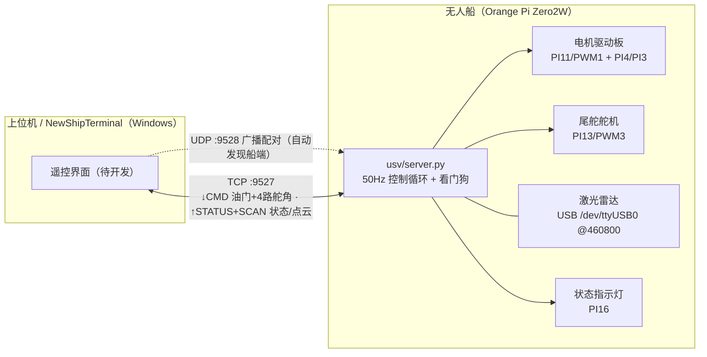

# USV Edge 无人船边缘端 —— 交接文档

- **交接日期**：2026-10-08
- **面向对象**：上位机（`NewShipTerminal`）开发同学 / 后续维护者
- **平台**：Orange Pi Zero2W（Allwinner H618），Ubuntu 20.04，Python 3.8
- **船端仓库**：`/home/orangepi/usv_edge`（SSH：`orangepi@192.168.3.9`）

---

## 1. 一分钟了解

船端服务器已就绪：`python3 main.py` 启动后，在手机热点网内以 **TCP 50Hz** 接收上位机遥控
（油门 + 4 路舵角），同步回传 **状态帧（50Hz）** 与 **激光雷达点云（约 10 圈/s）**，
并用指示灯反映链路/运行状态。上位机程序只需按 `docs/protocol.md` 收发二进制帧；
仓库自带可运行的参考客户端 `tools/pc_client.py`（纯标准库）。

```bash
# 船端（Orange Pi 终端）
python3 main.py                  # 实机运行（监听 0.0.0.0:9527）
python3 main.py --dry-run        # 无硬件演练（不碰 PWM/GPIO/串口）

# 上位机（电脑终端，已装 Python3）
python tools/pc_discovery.py                    # 自动发现局域网内的船（列 IP / TCP 端口 / 状态）
python tools/pc_client.py --discover --demo     # 或：发现后自动连接并演示
```

## 2. 系统架构



## 3. 硬件与接口（已实测锁定）

| 部件 | 引脚/接口 | 参数 | 备注 |
|---|---|---|---|
| 尾舵舵机 | PI13 · PWM3 | 50Hz 脉宽 | 已标定：中位 1590µs，软限位 1070~2110µs（含 30µs 余量自动保护） |
| 电机驱动板 | PI11 · PWM1 | 50Hz 占空比=油门 | 油门上限配置 60%（`hardware.json`） |
| 电机方向 | PI4 / PI3 | GPIO | 正转=PI3 高（`swap_dir=true`）；双高=急停、双低=待机 |
| 指示灯 | PI16 | GPIO | 状态节拍闪烁（见 §8） |
| 激光雷达 | USB | 思岚 C1，460800 bps | 命令式：需发 START SCAN 才输出（`usv/lidar_stream.py` 已自动处理） |
| TTL 调试口 | PH0/PH1 · UART0 | 115200 | 内核日志/登录（排针 8/10），非雷达口 |

> 舵机与电机的电气标定全部在 `config/hardware.json` 内，换硬件后请重新运行
> `python3 archive/calibrate_servo_limit.py` 复标。
>
> 雷达排查：船端 `lsusb` 应见 `10c4:ea60`（CP210x 解码器）、`/dev/ttyUSB0` 应存在；
> 缺失 = USB 未识别（查雷达 5V 供电与线缆），插回后服务器 5 秒内自动重连（无需重启）。
>
> 直连 UART0 **不可行**（2026-10-10 实测复核）：所有 UART 挂在 `apb2 = 24MHz`，BSP 整数
> 分频无法产生 460800（460800 × 16 = 7.3728 MHz 与 24 MHz 之比为 192/625）；
> 雷达必须经 USB 串口桥连接（原厂解码器或通用 CP2102/CH340/FT232，需支持 460800）。

## 4. 网络与地址

| 设备 | 地址 | 说明 |
|---|---|---|
| 本地 WiFi | SSID `Huawei AX2 Pro` | 网段 `192.168.3.0/24` |
| 无人船（船端服务器） | `192.168.3.9` | 监听 `0.0.0.0:9527`；配对广播 UDP `9528` |
| 上位机电脑 | `192.168.3.x`（DHCP，无需固定） | 可用 `tools/pc_discovery.py` 自动发现 |
| 路由器网关 | `192.168.3.1` | DHCP |

- 热点 DHCP 地址可能变化：上位机连不上时先在船端运行 `hostname -I` 确认当前 IP；
- 若上位机想固定连接目标，可在船端配置静态 IP 或热点里做绑定（当前未做）；
- 船端若启用过 ufw 防火墙，需 `sudo ufw allow 9527/tcp`（当前默认未启用）；
- 自动发现还需放行 UDP：`sudo ufw allow 9528/udp`；若路由器开了「AP 隔离/客户端隔离」，设备之间会互相看不见，需关闭；
- 船端默认每 1 s 广播一次配对信息（名称/SN/IP/TCP 端口/状态），上位机监听即可自动找到船，无需写死 IP。
- **单客户端**策略：新连接会顶替旧连接（便于重连调试）。

## 5. 通信协议 v1（摘要）

完整字段表、示例帧、C 参考实现见 **[docs/protocol.md](protocol.md)**。要点：

- 帧格式（小端）：`AA 55 | ver=1 | type | seq(u16) | len(u16) | payload | crc16`
- CRC16-CCITT-FALSE（poly=0x1021，init=0xFFFF），覆盖 `ver..payload`；
- 三种帧：

| type | 名称 | 方向 | 频率 | 内容 |
|---|---|---|---|---|
| `0x01` | CMD | 上位机 → 船 | 50Hz | 油门 i16（0.1%，符号=方向）+ 4×舵角 i16（0.1°）+ 标志（bit0 解锁 / bit1 急停） |
| `0x81` | STATUS | 船 → 上位机 | 50Hz（每周期一帧） | 实际输出、方向、生效标志、rx_seq/rx_errors、点云统计、实测循环频率 |
| `0x82` | SCAN | 船 → 上位机 | 每圈一份 | 点云 `(角度 0.01°, 距离 mm, 强度 u8)`，可选 zlib 压缩 |

- 示例 CMD（油门 +15.0%、舵 10.0°、解锁，seq=1）：
  `aa 55 01 01 01 00 0c 00 96 00 64 00 00 00 00 00 00 00 01 00 4e 58`

## 6. 上位机接入指南（NewShipTerminal）

1. **连接**：TCP `192.168.3.9:9527`（推荐先用 UDP 广播自动发现，见下），务必设置 `TCP_NODELAY`（避免 50Hz 小包延迟抖动）；
2. **发送**：以 20ms 周期发 CMD，`seq` 自增（便于对侧统计丢包）；**必须每 300ms 内至少一帧**，
   否则船端进入失联保护（油门 0 + 舵回中，LED 急促闪）；
3. **解锁**：默认 `require_arm=true`，先观察链路（不带 ARM 位）确认后再置 `flags.arm=1`，
   此后需**持续**带 ARM 位，否则电机不输出；
4. **接收**：按帧解析并解 CRC；STATUS 刷新 UI（50Hz），SCAN 解 zlib 后绘点云（约 10Hz）；
5. **急停**：任意 CMD 帧置 `flags.estop=1` 即触发双高刹车；撤销后（并保持 ARM）恢复控制；
6. **参考实现**：`tools/pc_client.py` 是完整可运行的最小客户端（协议编解码 + 发送节奏 + 显示），
   建议直接移植/改写；
7. **UI 建议**：显示 STATUS 的 `loop_hz_x10`（船端实测频率）、`rx_errors`、`flags` 与 `points_last`，
   便于一眼判断链路与雷达状态；
8. **带宽预算**：CMD 22B×50Hz≈1.1KB/s；STATUS 36B×50Hz≈1.8KB/s；
   点云 500 点/圈（zlib 后约 1~3KB）×10Hz≈10~30KB/s —— 热点 WiFi 余量充足。

## 7. 船端软件结构

| 文件 | 职责 |
|---|---|
| `main.py` | 入口：参数解析、组件装配、安全退出（Ctrl+C / SIGTERM） |
| `usv/server.py` | TCP 服务器：accept/rx 线程 + 50Hz 控制循环 + 看门狗 + 点云发送 |
| `usv/protocol.py` | 协议 v1 权威实现（组帧 / CRC / 增量解析器 `FrameParser`） |
| `usv/lidar_stream.py` | 雷达流式读取：C1 紧凑格式解析（自动对齐）、自动重连、模拟雷达（dry-run） |
| `usv/logutil.py` | 日志：所有输出前缀运行时间戳 `[T+HH:MM:SS.mmm]`（毫秒精度） |
| `usv/status_led.py` | 指示灯状态机（独立线程，见 §8） |
| `usv/motor.py` / `usv/servo.py` / `usv/pwm.py` / `usv/gpio.py` | 硬件抽象层（HAL） |
| `config/hardware.json` | 引脚 / 标定 / 限幅（**实机参数在此**） |
| `config/server.json` | 网络 / 控制回路 / 上传策略 |
| `tools/pc_client.py` | 上位机联调客户端（纯标准库，Windows 可直接运行） |
| `docs/protocol.md` | 协议字段表 + 示例帧 + C 实现 |
| `archive/` | 开发期测试/调试脚本存档（仍可运行，见 `archive/README.md`） |

## 8. 指示灯状态（PI16，一眼判断船的状态）

| 闪烁 | 状态 | 含义 |
|---|---|---|
| 三连快闪 | BOOT | 启动自检 |
| 慢速双闪（0.4/0.4×2 + 长灭1.2s） | WAIT_LINK | 等待上位机连接 |
| 慢心跳（0.3/1.5s） | READY | 已连接、待命（未解锁） |
| 快心跳（0.08/0.5s） | ACTIVE | 已解锁、控制中 |
| 急促连续闪（150/150ms） | FAILSAFE | 指令超时，失联保护已生效（油门0+舵回中） |
| 极速连续闪（60/60ms） | ESTOP | 急停中 |

## 9. 安全机制（都已实测）

1. **看门狗**：`watchdog_ms`（默认 300ms）无有效指令 → 油门 0 + 舵回中；
2. **解锁位**：`flags.arm` 持续为 1 电机才输出；
3. **急停**：`flags.estop=1` → 方向双高刹车；
4. **断连保护**：上位机断开 / 进程 Ctrl+C / SIGTERM → 安全停车（PWM 保持 0% 使能防悬空）；
5. **舵机软限位**：任何指令都会被钳位在标定范围内（超限拒绝）；
6. **油门限幅**：`max_throttle_percent=60`，可用 `--max-throttle` 临时再压低。

## 10. 验证记录（2026-10-08）

- 协议编解码回环（分片/噪声/CRC/zlib）全过；CRC 标准向量 `"123456789" → 0x29B1`；
- dry-run 全链路：客户端 50.0Hz 平均收发、船端循环 49.7~50.2Hz、点云 10 圈/s×500 点、
  **0 丢包 0 CRC 错**；
- 看门狗：停发指令 300ms 内 LED 切 FAILSAFE 并安全输出，恢复指令后回到 ACTIVE；
- 优雅退出：Ctrl+C / SIGTERM 均输出 `已安全退出（油门 0，舵回中）`。

复现命令：

```bash
# 船端
python3 main.py --dry-run
# 上位机/本机
python3 tools/pc_client.py --host 127.0.0.1 --demo --duration 10
```

## 11. 已知限制与后续建议

- **上位机 GUI 未开发**（即 `NewShipTerminal` 的目标）：协议、参考客户端、联调工具已全部就绪；
- 未配置开机自启：建议后续加 systemd 服务（`Restart=always`，SIGTERM 安全退出已支持）；
- 单客户端、无鉴权（当前仅在热点内使用；如需管控可启用 `client_whitelist`）；
- 未做自主避障：点云数据已在每帧 SCAN 中输出，可直接作为避障输入；
- 舵机通道 2~4 为协议预留（未接硬件，仅在 STATUS 中回显）；
- 时间戳为船端单调时钟（ms），只建议用于相对时间/延迟观测。

## 12. 文件与获取方式

本交接包的副本位于船端 `usv_edge/transfer/usv_edge_handover/`（含
`HANDOVER.md`、`protocol.md`、`pc_client.py`、`server.json`）。

**在 Windows 电脑上获取（PowerShell，一条命令，会提示输入船端密码）**：

```powershell
scp -r orangepi@192.168.3.9:/home/orangepi/usv_edge/transfer/usv_edge_handover \
    "C:\Users\eric2\OneDrive - Guangdong Technion-Israel Institute of Technology\Mingyi LIU 刘鸣艺's files - Suiqi Li\NewShipTerminal\"
```

> 其他方式：① VS Code Remote 中右键文件 → “Download…”；
> ② 船端执行 `python3 -m http.server 8000 --directory transfer`，浏览器访问 `http://192.168.3.9:8000/` 下载。

## 13. 常用命令速查

| 目的 | 命令（船端执行） |
|---|---|
| 实机启动 | `python3 main.py` |
| 无硬件演练 | `python3 main.py --dry-run` |
| 限制油门运行 | `python3 main.py --max-throttle 20` |
| 不用雷达 | `python3 main.py --no-lidar` |
| 强制指定雷达串口 | `python3 main.py --lidar-port /dev/ttyUSB1` |
| 雷达 UART 直连（500000bps） | `python3 main.py --lidar-port /dev/ttyAS0 --lidar-bypass-div 3`（雷达需支持 500000；需 root；直连期间串口控制台不可用） |
| 上位机演示 | `python3 tools/pc_client.py --discover --demo` |
| 急停测试 | `python3 tools/pc_client.py --host 192.168.3.9 --estop` |
| 自动发现 | `python3 tools/pc_discovery.py --timeout 0` |
| 雷达单测（归档脚本） | `python3 archive/test_lidar.py --seconds 10` |
| 舵机复标（归档脚本） | `python3 archive/calibrate_servo_limit.py` |
| 编译自检 | `python3 -m py_compile main.py usv/*.py tools/pc_client.py` |
