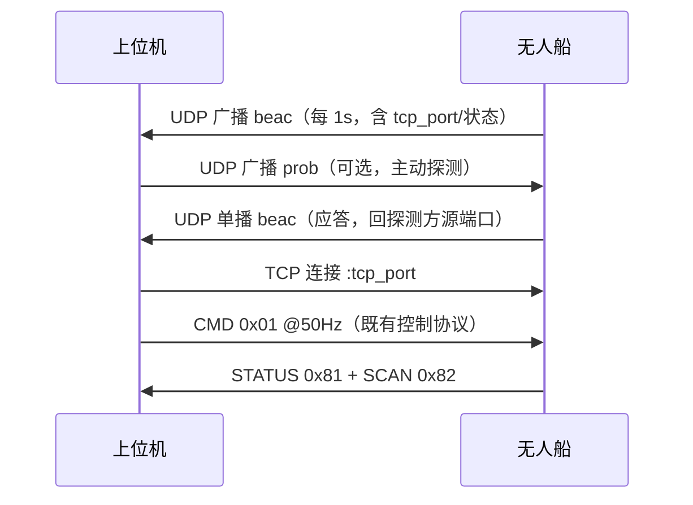

# USV Edge 通信协议 v1（TCP）

- 传输：TCP，船端默认监听 `0.0.0.0:9527`（当前热点网：船 `192.168.43.25`，上位机 `192.168.43.20`）；
- 默认指令频率：**50Hz**（上位机每 20ms 发一帧 CMD）；点云按雷达实际圈率回传（思岚 C1 约 8~12Hz）；
- 字节序：**小端（LE）**；校验：**CRC16-CCITT-FALSE**（poly=0x1021，init=0xFFFF）；
- 单客户端：新连接顶替旧连接（便于联调重连）；船端 300ms 收不到有效指令即进入失联保护。

## 1. 帧结构

| 偏移 | 长度 | 字段 | 说明 |
|---|---|---|---|
| 0 | 2 | 帧头 | 固定 `AA 55` |
| 2 | 1 | ver | 协议版本，当前 `0x01` |
| 3 | 1 | type | 帧类型（见下表） |
| 4 | 2 | seq | 发送序列号 u16（0..65535 回绕） |
| 6 | 2 | len | 载荷长度 u16（≤ 8192） |
| 8 | len | payload | 载荷 |
| 8+len | 2 | crc16 | CRC16-CCITT-FALSE，覆盖 **ver..payload**（偏移 2 至 8+len，不含帧头与 CRC 自身） |

### 帧类型

| type | 名称 | 方向 | 频率 | 说明 |
|---|---|---|---|---|
| 0x01 | CMD | 上位机 → 船 | 50Hz | 遥控：油门 + 4 路舵角 + 标志位 |
| 0x81 | STATUS | 船 → 上位机 | 50Hz | 实际输出、链路质量、雷达统计 |
| 0x82 | SCAN | 船 → 上位机 | 每圈一次 | 激光雷达点云（可选 zlib 压缩） |

## 2. CMD（0x01，载荷 12 字节）

| 偏移 | 类型 | 字段 | 单位/范围 | 说明 |
|---|---|---|---|---|
| 0 | i16 | throttle_x10 | 0.1%，±1000 = ±100.0% | 符号=方向：正=前进、负=后退、0=停车（|v| < deadband 视为停） |
| 2 | i16 | servo1_x10 | 0.1°，±1800 | 通道 1 = 尾舵（当前唯一实装），正=右（软限位内自动钳位） |
| 4 | i16 | servo2_x10 | 0.1° | 预留（当前仅回显） |
| 6 | i16 | servo3_x10 | 0.1° | 预留（当前仅回显） |
| 8 | i16 | servo4_x10 | 0.1° | 预留（当前仅回显） |
| 10 | u8 | flags | 位域 | bit0=ARM 解锁；bit1=ESTOP 急停（方向双高刹车） |
| 11 | u8 | rsv | 0 | 保留 |

## 3. STATUS（0x81，载荷 26 字节）

| 偏移 | 类型 | 字段 | 说明 |
|---|---|---|---|
| 0 | u32 | time_ms | 船端 CLOCK_MONOTONIC 毫秒（自系统启动；仅用于相对时间） |
| 4 | i16 | throttle_x10 | 实际输出油门 0.1%（符号=方向） |
| 6 | u8 | direction | 0=停、1=前进、2=后退、3=急停 |
| 7 | i16×4 | servo_x10[4] | 各通道指令回显 0.1°（协议层钳位后） |
| 15 | u8 | flags | bit0 已解锁 / bit1 急停 / bit2 失联保护 / bit3 雷达在线 / bit4 需要解锁 |
| 16 | u16 | rx_seq | 船端最近收到的 CMD 序列号（上位机可估计丢包/延迟） |
| 18 | u16 | rx_errors | 船端累计接收错误数（CRC/长度/解析），回绕 |
| 20 | u16 | points_last | 最近一圈点云点数 |
| 22 | u16 | scans_total | 累计完成圈数（回绕） |
| 24 | u16 | loop_hz_x10 | 船端实测控制循环频率 ×10（500 = 50.0Hz） |

## 4. SCAN（0x82，点云）

载荷 = 8 字节头 + 点数据：

| 偏移 | 类型 | 字段 | 说明 |
|---|---|---|---|
| 0 | u32 | time_ms | 圈完成时刻（船端单调时钟毫秒） |
| 4 | u16 | count | 点数 |
| 6 | u8 | encoding | 0=原始；1=zlib（点数据整体压缩） |
| 7 | u8 | rsv | 0 |

点数据（encoding=0 直接排列；encoding=1 先 zlib 解压）：

| 偏移 | 类型 | 字段 | 说明 |
|---|---|---|---|
| 0 | u16 | angle_cdeg | 0.01°（0..35999） |
| 2 | u16 | dist_mm | 距离 mm（0=无效，船端已剔除） |
| 4 | u8 | quality | 信号强度 0..255 |

> 船端默认策略：zlib 压缩、每圈最多 1000 点（超出按等角度抽稀）、待发缓存丢旧保新。

## 5. 时序与容错

- 上位机以 20ms 节拍发 CMD（seq 递增）；船端每个控制周期回一帧 STATUS，点云帧紧随其后发出；
- **看门狗**：船端超过 `watchdog_ms`（默认 300ms）未收到有效帧 → 失联保护（油门 0、舵回中，STATUS 置 bit2）；
- **CRC 错误**：接收端丢弃该帧并重新同步（船端计入 `rx_errors`，不影响链路）；
- **TCP_NODELAY** 两端已开启（避免 Nagle 聚合小包带来的 50Hz 延迟抖动）；SO_KEEPALIVE 已开启；
- **单客户端**：新连接顶替旧连接，船端回到安全态并等待新指令。

## 6. 示例帧（十六进制，小端）

CMD：油门 +15.0%（150）、舵 10.0°（100）、解锁，seq=1：

```
aa 55 01 01 01 00 0c 00 | 96 00 64 00 00 00 00 00 00 00 01 00 | 4e 58
帧头  ver ty seq len      throttle=150   servo1=100  ...      flags=0x01  CRC=0x584e
```

STATUS：50.0Hz、前进 15.0%、舵 10.0°、已解锁+雷达在线、rx_seq=1、480 点、3 圈，seq=0：

```
aa 55 01 81 00 00 1a 00 | e8 03 00 00 96 00 01 64 00 00 00 00 00 00 00 09 01 00 00 00 e0 01 03 00 f4 01 | 47 6d
```

SCAN：3 个点（0°=1000mm、120°=2000mm、240°=3000mm）、未压缩，seq=0：

```
aa 55 01 82 00 00 17 00 | e8 03 00 00 03 00 00 00 | 00 00 e8 03 50  e0 2e d0 07 5a  c0 5d b8 0b 64 | ed b0
```

## 7. CRC 参考实现（C）

```c
#include <stdint.h>
#include <stddef.h>

uint16_t crc16_ccitt(const uint8_t *data, size_t len) {
    uint16_t crc = 0xFFFF;
    for (size_t i = 0; i < len; i++) {
        crc ^= (uint16_t)data[i] << 8;
        for (int b = 0; b < 8; b++)
            crc = (crc & 0x8000) ? (uint16_t)((crc << 1) ^ 0x1021) : (uint16_t)(crc << 1);
    }
    return crc;
}
```

标准校验向量：`"123456789"` → `0x29B1`。

## 8. 参考实现

- 船端：`usv/protocol.py` —— 本协议的权威实现（组帧/解析/增量解析器 `FrameParser` 全部含单元自检）；
- 上位机：`tools/pc_client.py` —— 纯标准库联调客户端，内嵌同一协议的简化实现。

> 修改协议时：先改 `usv/protocol.py`，同步 `tools/pc_client.py` 与本文件，并将版本号 +1。

---

# USV Edge 配对发现 v1（UDP 广播，独立于上面的 TCP 帧协议）

船端默认每 1 s 广播一次，让上位机**不需要事先知道船端 IP**。它不占用 TCP 帧类型号，
CS 上也不是一条控制链路——只是「自我介绍」。

## 9. 报文格式

报文是「固定前缀 + JSON」，单包不超过 1400 字节（避免超 MTU）：

```
+------------+--------+----------------------------------------------+
| MAGIC (8B) | kind4B | UTF-8 JSON (变长)                              |
| "USVDISC1" | beac   | {"name":"USV-Edge","tcp_port":9527,...}      |
|            | prob   | {}（上位机->船：请求应答）                     |
+------------+--------+----------------------------------------------+
```

| kind | 方向 | 目的地址 | 含义 |
|---|---|---|---|
| `beac` | 船 → 局域网 | `255.255.255.255:9528`、`<子网>.255:9528`、或探测方的单播地址 | 配对信息广播 / 应答 |
| `prob` | 上位机 → 局域网 | 同上 | 请求船端应答 |

## 10. JSON 字段（kind=`beac`）

| 字段 | 类型 | 说明 |
|---|---|---|
| `kind` | string | 固定 `"usv"`（设备类型，便于以后扩展成其他设备） |
| `ver` | int | 配对协议版本，当前 `1` |
| `name` | string | 设备名，可由 `--device-name` 覆盖（多船区分） |
| `sn` | string | 设备序列号（`/etc/machine-id` 前 8 位，大写十六进制） |
| `tcp_port` | int | **控制链路 TCP 端口**（发现后连这个） |
| `ips` | string[] | 船端本机非回环 IPv4 |
| `state` | string | `idle` / `ready` / `armed` / `failsafe` / `estop` |
| `client` | string/null | 当前已连接的上位机 IP（已占用时为非空） |
| `armed` / `estop` / `failsafe` | bool | 船端安全位状态 |
| `lidar` | bool | 雷达是否在线 |
| `hz` | float | 当前控制回路实际频率 |
| `uptime_s` | float | 船端服务已运行秒数 |
| `t` | int | 船端 Unix 时间戳（秒） |
| `reply_to_probe` | bool | 船端是否开启探测应答 |

## 11. 交互流程



## 12. 参考实现

- 船端：`usv/discovery.py`（`DiscoveryBeacon`，含 `pack_discovery` / `unpack_discovery`）；
- 上位机：`tools/pc_discovery.py`（独立发现工具）、`tools/pc_client.py --discover`（自动发现后再连）。

> 修改配对协议时：先改 `usv/discovery.py`，同步 `tools/pc_discovery.py` 与 `tools/pc_client.py` 内嵌副本及本文件。
